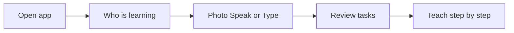

# Arjuna — Product Overview

Voice-first homework tutor for kids (Telugu / English). Parents open the app, set up a child, then scan or speak homework. Arjuna teaches step by step.

**Live app:** https://arjuna-ai-tutor.vercel.app  
**APK (phone + TV):** https://arjuna-ai-tutor.vercel.app/download

---

## How it works (family path)

1. Open the app (web or APK).
2. **Who’s learning?** — enter child name (optional grade, board, school medium).
3. **Homework** — scan diary photo / PDF, speak, or type.
4. Review extracted tasks → **Start teaching**.
5. Arjuna explains one task at a time; child can ask “explain again” or raise a doubt.
6. Optional: photo of the child’s answer for AI check; parent PIN unlocks full solution.

No family code or WhatsApp invite is required.



---

## Features

### Core

| Feature | Description |
|---|---|
| Child profiles | Up to 3 kids on one device (name, grade, board, medium) |
| Language modes | Pure Telugu · Mixed · English only (`Settings`) |
| Voice in/out | Speak homework; Arjuna talks back (Sarvam AI) |
| Photo homework | Scan diary / PDF → Gemini extracts tasks |
| Type homework | Type or paste if no photo |
| Task review | Fix subject/task before teaching |
| Step-by-step teaching | One task at a time |
| Explain again / doubts | Extra help mid-lesson |
| Answer check | Photo of work → AI verifies |
| Parent PIN | Unlock full solution when stuck |
| Streaks / daily target | Light habit tracking |

### Tabs

| Tab | Route | Features |
|---|---|---|
| Homework | `/` | Capture → review → teach |
| Exam | `/exam` | Timetable photo, revise, practice quiz, weekly planner |
| English | `/english` | Concepts, daily words, journal |

### Devices

| Feature | Description |
|---|---|
| Phone web | Browser |
| Android APK | One APK for phone + Android TV (`/download`) |
| TV mode | `/tv` — phone uploads; lesson on TV (or TV-only) |

### Parent / owner

| Feature | Route | Description |
|---|---|---|
| Settings | `/settings` | Language, Gemini key, curriculum upload, feedback |
| Owner dashboard | `/owner` | Invites (legacy), sessions, parent feedback |
| Analytics | `/owner/analytics` | Usage event counts |
| Roadmap | `/roadmap` | Shipped vs backlog |

---

## Types & modes (product language)

These are the main choices parents/kids see or that shape teaching.

### Language mode

| Value | Meaning |
|---|---|
| `pure_telugu` | Speak and teach only in Telugu |
| `mixed` | English + Telugu together (default) |
| `english` | English only |

### Device mode

| Value | Meaning |
|---|---|
| `phone_only` | Everything on the phone (default) |
| `phone_tv` | Phone controls; TV shows the lesson |
| `tv_only` | Lesson runs on TV |

### School board

`CBSE` · `ICSE` · `IB` · `State`

### Medium of instruction

| Value | Meaning |
|---|---|
| `english_medium` | Private / English-medium school (default) |
| `telugu_medium` | Government Telugu-medium school |

### Grades

Nursery · LKG · UKG · Grade 1–10

### Teaching methods (Settings / AI guidance)

| Value | Label idea |
|---|---|
| `nep_ncf` | NEP / NCF style |
| `activity_based` | Activity-based |
| `montessori` | Montessori |
| `inquiry_ib` | Inquiry / IB |
| `play_way` | Play-way |
| `experiential` | Interactive diary tutor |
| `traditional` | Traditional |

### Homework capture modes

- Camera / gallery photo (diary page)
- PDF (converted to images on device)
- Speak (mic → transcript → extract tasks)
- Type text
- Manual “add tasks myself”

---

## Tech stack (short)

| Layer | Tech |
|---|---|
| App | Next.js 14, React, TypeScript, Tailwind |
| Voice | Sarvam AI (`saaras:v3` STT, `bulbul:v3` TTS) |
| Vision / tutor AI | Google Gemini |
| Data | Supabase (optional for rooms, exams, curricula) |
| Mobile / TV | Capacitor Android (leanback launcher) |

---

## Local run

```bash
cp .env.example .env.local
# Set SARVAM_API_KEY and GEMINI_API_KEY
npm install
npm run dev
```

Open http://localhost:3000

Required keys:

| Key | For |
|---|---|
| `SARVAM_API_KEY` | Voice in and out |
| `GEMINI_API_KEY` | Reading photos + tutoring |
| `OWNER_PASSWORD` | `/owner` dashboard |

---

## What changed recently (invite gate)

Families used to need a WhatsApp invite / family code. That gate is removed. Opening the app goes straight to **Who’s learning?** Profiles still store a silent internal `inviteCode: "local"` so exams and analytics keep working. Owner invite tools remain on `/owner` but are not required for kids.
